# Styling JSON, YAML, HCL and files diagrams

`@startjson`, `@startyaml`, `@starthcl` and `@startfiles` diagrams are drawn
by PlantUML from a style extractor that throws most styling away: for these
four diagram types the jar keeps only `skinparam handwritten true` and, for
JSON, YAML and files, `<style>` blocks and `skin`; HCL ignores `<style>`,
`skin` and `!theme` altogether (`StyleExtractor.java:88-96`,
`HclDiagramFactory.java:86-92`).

plantuml-ts **honours more of it by default**. This is a deliberate,
documented extension (maintainer ruling 2026-10-23, see
[Divergences](/divergences#extensions-user-ruling-2026-10-23)). A diagram that
carries none of these directives renders exactly as the jar renders it.

For JSON, YAML and HCL every `skinparam` (a theme's included) is converted to
the style it would set in a class diagram. Where that style shares a name with a
data-diagram element it restyles it: `node...` skinparams style the boxes,
`sequenceDivider...` the row separators, `arrow...` the arrows and
`roundCorner` the corners. That is why `!theme aws-orange` recolours JSON boxes.

The pages below list only directives that were measured to change the output.
Everything else listed in the divergences page as *ignored* is still ignored.

| Directive | json | yaml | hcl | files |
|---|---|---|---|---|
| `skinparam backgroundColor` | yes | yes | yes | yes |
| `skinparam defaultFontName`, `defaultFontSize`, `defaultFontColor` | yes | yes | yes | yes |
| `skinparam lengthAdjust none` / `spacingAndGlyphs` | yes | yes | yes | yes |
| `<style>` `jsonDiagram { node { ... } }` | jar already | no | no | no |
| `<style>` `yamlDiagram { node { ... } }` | no | jar already | yes | no |
| `skinparam roundCorner` | yes | yes | yes | no |
| `skin rose` | jar already | jar already | yes | no |
| `<style>` `document { ... }` | jar already | jar already | yes | jar already |
| `!theme aws-orange` | yes | yes | yes | yes |
| `!theme amiga` | jar already | jar already | yes | jar already |

"jar already" means the jar itself honours the directive, so it is not an
extension.

## Font family

`skinparam defaultFontName` changes the font of every key and value in JSON, YAML and HCL diagrams. `defaultFontSize` works the same way and resizes the boxes.

```plantuml
@startjson
skinparam defaultFontName Courier
{ "a": 1, "b": "x" }
@endjson
```

Port output (jar-compatible mode draws the default style instead):

<!--@include: ../../tests/fixtures/extensions/json-skinparam-fontname.svg-->

## Background colour

`skinparam backgroundColor` paints the canvas. It also works for files diagrams.

Port output (jar-compatible mode draws the default style instead):

<!--@include: ../../tests/fixtures/extensions/yaml-skinparam-background.svg-->

## Node style in HCL

In HCL diagrams a `<style>` block is honoured through the `yamlDiagram` selector: PlantUML styles an HCL diagram under the YAML name. `jsonDiagram` and `hclDiagram` select nothing there.

Port output (jar-compatible mode draws the default style instead):

<!--@include: ../../tests/fixtures/extensions/hcl-style-node.svg-->

## Themes in HCL

```plantuml
@starthcl
!theme amiga
resource "aws_instance" "web" {
  ami = "ami-123"
}
@endhcl
```

`!theme` applies its `<style>` blocks to HCL diagrams. The jar drops them.

Port output (jar-compatible mode draws the default style instead):

<!--@include: ../../tests/fixtures/extensions/hcl-theme-amiga.svg-->

## Files diagrams

Files diagrams take `skinparam backgroundColor`, `skinparam lengthAdjust` and `!theme`. Font skinparams are ignored for files.

```plantuml
@startfiles
skinparam backgroundColor #FFEEEE
/Alpha/
/Alpha/Bravo
@endfiles
```

Port output (jar-compatible mode draws the default style instead):

<!--@include: ../../tests/fixtures/extensions/files-skinparam-background.svg-->

## Text length adjustment

`skinparam lengthAdjust none` removes the `textLength` attribute from each text
element and the `lengthAdjust` attribute from the root group;
`spacingAndGlyphs` writes `lengthAdjust="spacingAndGlyphs"`. Without the
skinparam the output is the jar's `lengthAdjust="spacing"`. Pinned examples:
`tests/fixtures/extensions/*-skinparam-lengthadjust-*.puml`.

## Conformance

The conformance tooling renders these four diagram types in an internal
jar-compatible mode that drops the same input the jar drops, so the measured
fidelity against the jar is unaffected. Library users get the extended mode.
