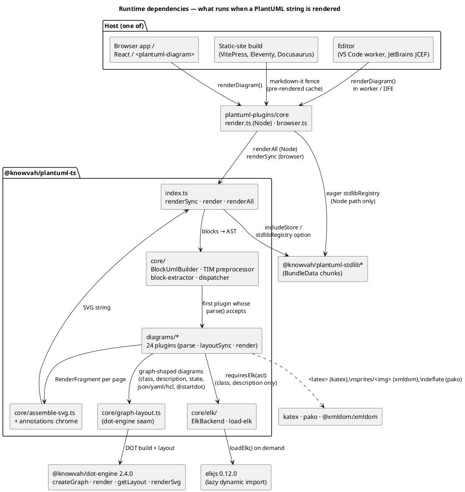
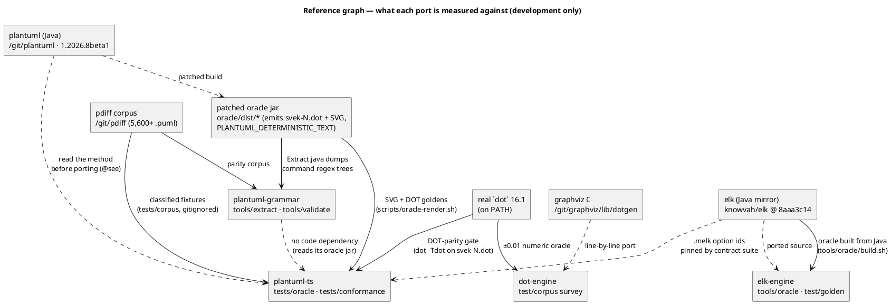

# System Architecture

Two views: the **runtime** graph (what executes when a diagram is rendered,
and from where) and the **reference/oracle** graph (what each port is
measured against). They are split because the first is shipped and the
second is a development concern, and mixing them hides which arrows carry
bytes at runtime.

## Runtime view

Communication is entirely **in-process and synchronous** except where a
host opts into the async API: `render`/`renderAll` await an injected
`fetcher` (for `!include` URLs and stdlib chunks, filtered by
`SecurityProfile`), an `imageProvider` (for remote ``), and the lazy
`loadElk()`. There are no network calls plantuml-ts makes on its own, no
databases, and no queues anywhere in the system. The only inter-process
hop is plantuml-plugins' optional `renderInChild` (a Node child process
used to enforce a render timeout at build time) and the VS Code
`worker_threads` worker.

### Boundaries enforced by tests, not convention

| Boundary | Enforced by |
|----------|-------------|
| `src/core/` never imports `src/diagrams/`; diagrams never import each other | `tests/architecture/layering.test.ts` |
| only `core/elk/load-elk.ts` imports `elkjs` | `tests/unit/elk/elk-import-boundary.test.ts` |
| `docs/catalog.md` matches the exported surface of `src/` | `tests/architecture/catalog.test.ts` (`npm run catalog:check`) |
| no Node built-ins / `process.env` / `Date.now()` in `src/` | lint + `tests/architecture/*` seam rules |
| workspace packages' peer range tracks the library version | `tests/architecture/packages-peer-range.test.ts` |

## Reference and oracle view

Two rules from `CLAUDE.md` shape this graph: *the Java is the spec* (every
ported symbol carries a `@see` to its origin; a divergence exists only
where a library forces it and is named in `DIVERGENCES.md`), and *one
layout engine* (dot-engine replaces Smetana wherever upstream would use it;
geometry deltas on those paths are recorded, not chased). Where upstream
shells out to real Graphviz, the jar's `svek-N.dot` **is** a target, and
`tests/oracle` gates DOT parity; where upstream uses Smetana (json, yaml,
hcl, `@startgit`), no `.dot` is emitted and only readability is gated.

## Deployment

There is no deployed service. Artifacts are:

| Artifact | Built by | Published to |
|----------|----------|--------------|
| `@knowvah/plantuml-ts` (`dist/plantuml-ts.{js,cjs}` + `image-providers`) | `npm run build` (Vite lib) | npmjs (manual, `RELEASING.md`; not yet published) |
| `@knowvah/plantuml-stdlib*`, `-sprites-archimate`, `-emoji`, `-all` | `npm run build:stdlib` | npmjs (manual) |
| `@knowvah/dot-engine` | esbuild + `tsc` declarations | npmjs via semantic-release; mirrored to GitHub Packages |
| `@knowvah/theme` | tsup | GitHub Packages on `theme/v*` tags |
| `@knowvah/plantuml-grammar` | `tools.emit.build` + TS build | npmjs via semantic-release; mirrored to GitHub Packages |
| plantuml.knowvah.com | VitePress (`docs.yml`) | GitHub Pages |
| plantuml-plugins packages, VS Code and JetBrains plugins | tsup / esbuild / Gradle | not published (no CI) |
