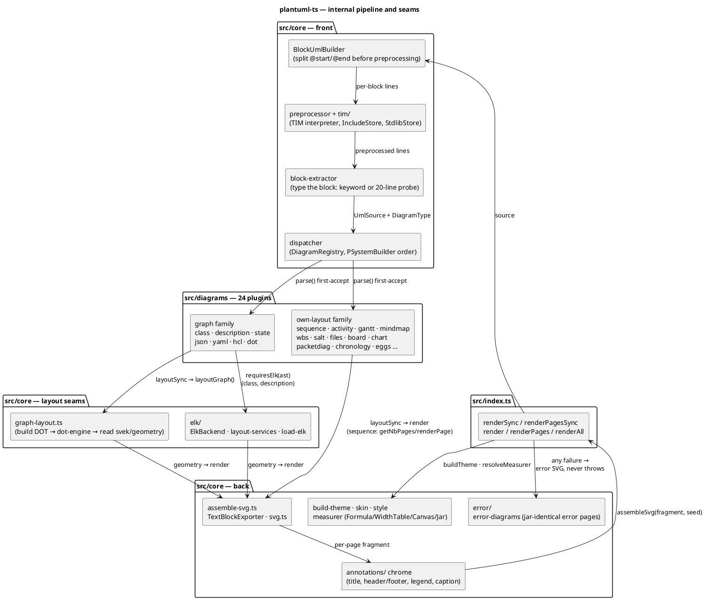
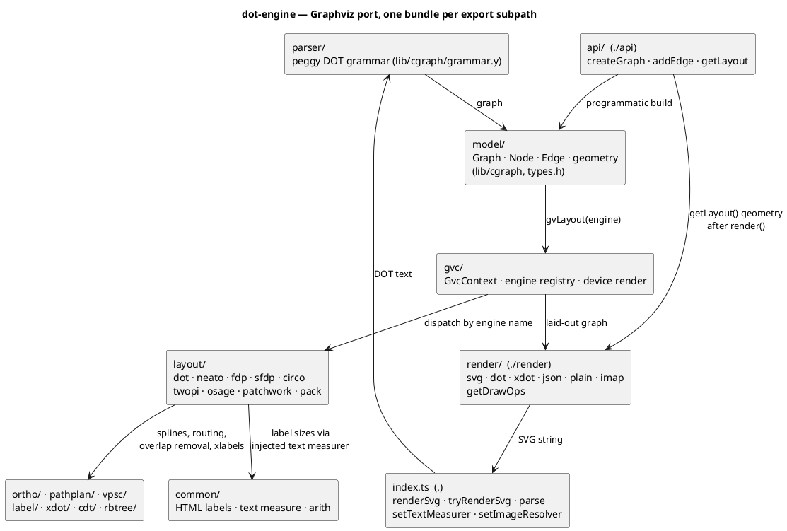
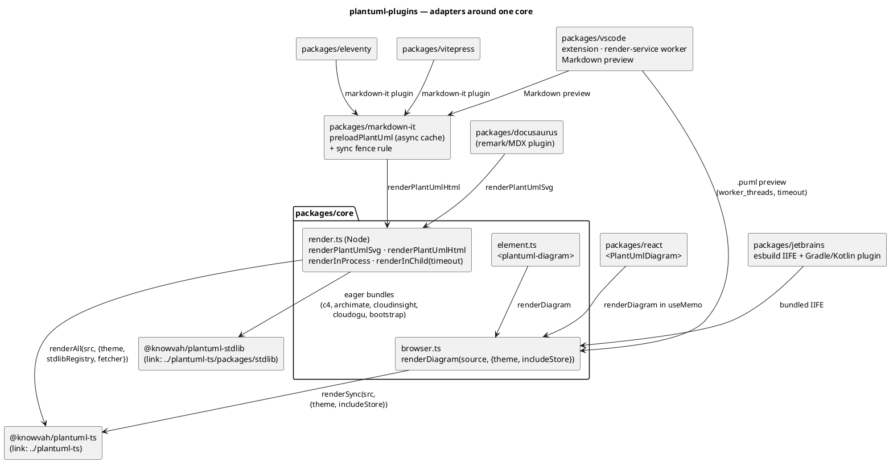
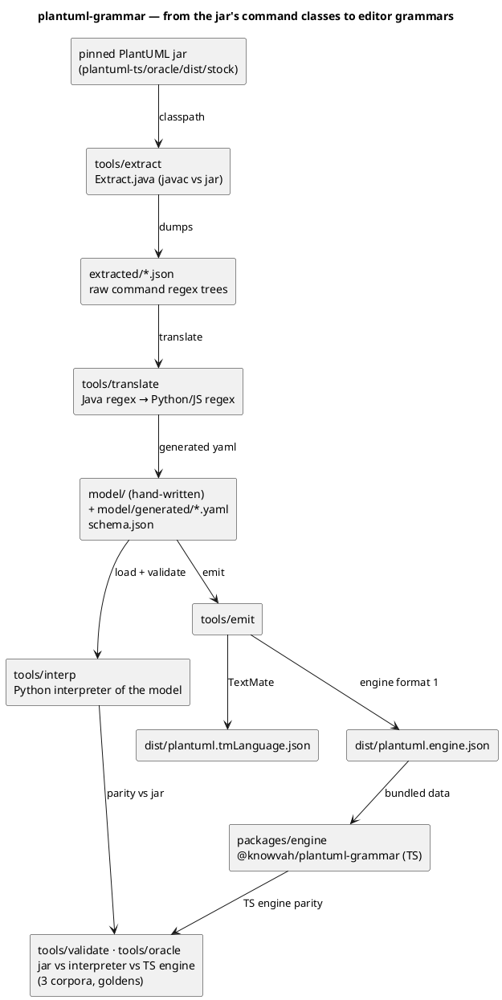
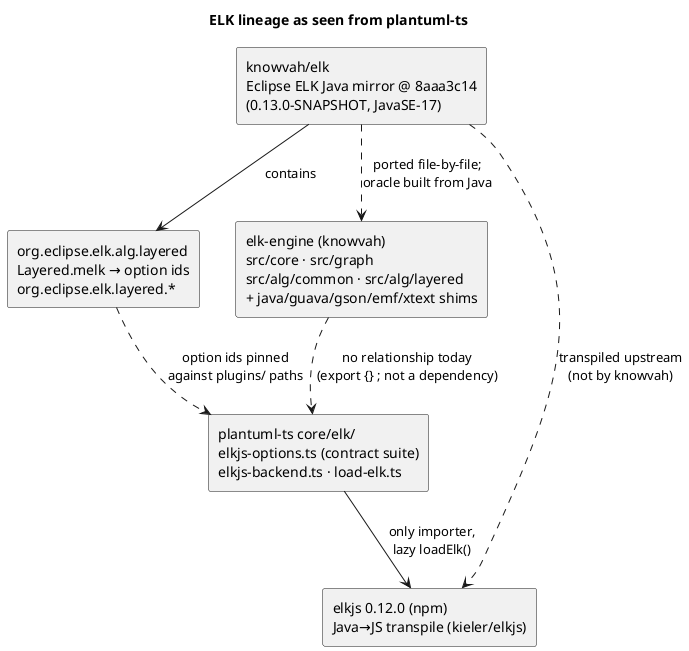

# Components

Per-repo internal structure. Each diagram is capped near 15 nodes; where a
repo has more modules than that, the diagram shows the layers and the
table below it names the modules. For *does a module for X exist* in
plantuml-ts, `docs/catalog.md` (generated, drift-gated) is the authority —
2,032 modules, 7,036 exported names as of this writing.

## plantuml-ts

### Module map

| Area | Modules (representative) | Role |
|------|--------------------------|------|
| Public API | `src/index.ts`, `src/registered-plugins.ts`, `src/image-providers/*` | render functions, option/error types, plugin registration in upstream factory order, network/browser image providers |
| Block stage | `core/BlockUmlBuilder.ts`, `core/preprocessor.ts`, `core/tim/*` (`IncludeStore`, `StdlibStore`, `StdlibRegistry`, `StdlibRemote`), `core/include-resolver*.ts`, `core/security/*` | document → blocks → preprocessed lines; `!include`/stdlib resolution; `SecurityProfile`, `SURL`, URL allowlist |
| Typing + dispatch | `core/block-extractor.ts`, `core/dispatcher.ts`, `core/dispatcher-types.ts` (`SyncPlugin`/`AsyncPlugin`) | diagram type from `@start<type>` or probe; ordered `parse()` attempts, `DiagramRefusal` |
| Theme/style/skin | `core/build-theme.ts`, `core/skin-command.ts`, `core/style/*`, `core/skinparam*`, `core/klimt/*` (sprites, fonts, colours) | upstream `StyleBuilder`/`SkinParam` semantics; klimt = upstream's drawing primitives |
| Text | `core/measurer*.ts` (`FormulaMeasurer`, `WidthTableMeasurer`, `CanvasMeasurer`, `JarMeasurer`, `DeterministicMeasurer`), `core/creole*.ts`, `core/code/*`, `core/abel/*` | string widths (the oracle seam), creole markup → atoms → SVG, `<code>`, `<latex>` via KaTeX |
| Graph layout | `core/graph-layout*.ts` (build-edges/-cluster/-portcluster/-borderpoint/-kermor/-svek-read), `core/dot-splines.ts`, `core/edge-label-box*.ts`, `core/cucadiagram/*`, `core/atmp/*` | port of `CucaDiagram`/`svek`: DOT text in, `svek-N.dot`-shaped geometry out; `Kermor` port clusters |
| ELK | `core/elk/elk-backend.ts`, `elkjs-backend.ts`, `elkjs-options.ts`, `layout-services.ts`, `load-elk.ts` | upstream `CucaDiagramFileMakerElk`; option ids pinned to `knowvah/elk` `.melk` |
| Chrome + assembly | `core/annotations/*`, `core/assemble-svg*.ts`, `core/TextBlockExporter.ts`, `core/svg.ts`, `core/document-margin.ts` | title/legend/header/footer/caption placement, `<defs>` arrowheads, root `<svg>` attributes, deterministic ids from `seedOfUmlSource` |
| Errors | `core/error/*` | jar-identical error pages (`PSystemError`), with our own version string by ruling |
| Plugins | `diagrams/<name>/{index,ast,parser*,layout*,renderer*}.ts` | one directory per upstream factory; see table in [inventory.md](inventory.md) |
| Seams (all injected via `RenderOptions`) | `measurer`, `includeStore`/`fetcher`, `stdlibRegistry`, `assetStore`, `imageProvider`, `securityProfile`, `elk`, internal `clock` | everything non-deterministic or I/O-shaped enters here; `src/` has no Node built-ins |

### Plugin → engine table

| Engine | Plugins | Entry |
|--------|---------|-------|
| dot-engine (real-Graphviz paths; DOT parity gated) | class, description (component/deployment/usecase/object), state | `layoutGraph()` in `core/graph-layout.ts` |
| dot-engine as Smetana replacement (no DOT gate) | json, yaml, hcl | shared `layoutJson()` in `diagrams/json/layout.ts` |
| dot-engine direct | dot (`@startdot`) | `renderSvg(dotContent, 'dot')` in `diagrams/dot/layout.ts` |
| ELK (elkjs) on `!pragma layout elk` | class, description | `layoutClassElk` / `layoutDescriptionElk` |
| own layout | sequence (multi-page via `newpage`), activity (tile layout), gantt, mindmap (Finger), wbs, salt, files, board, chart, packetdiag, chronology, dedication, donors, eggs, emoji, openiconic, version, archimate-sprite list | each plugin's `layoutSync` |

## dot-engine

plantuml-ts touches three exports: `createGraph` (`./api`) to build the
graph without emitting DOT text for parsing, `render(g, 'svg', {engine})`
(`./render`) to run layout, and `getLayout(g, {yAxis})` (`./api`) to read
node/edge/cluster geometry in svek's coordinate convention. `@startdot`
uses `renderSvg` from the root bundle. The text measurer is injected once
by `core/dot-engine-measurer.ts` so label sizes match plantuml-ts's own.

## plantuml-plugins

## plantuml-grammar

## ELK lineage: elk → elkjs → elk-engine

## common (`@knowvah/theme`)

Single package, no diagram needed. Exports: `.`/`./react`
(`ThemeProvider`, `useTheme`, icons), `./css` (tokens keyed on
`data-color-mode`/`data-contrast`), `./vitepress` (a hand-copied
restatement mapping the palette onto `--vp-*`), `./assets/*` (logos).
plantuml-ts's docs-site imports `@knowvah/theme/vitepress` and copies the
logo via `docs-site/copy-brand-assets.mjs`.
