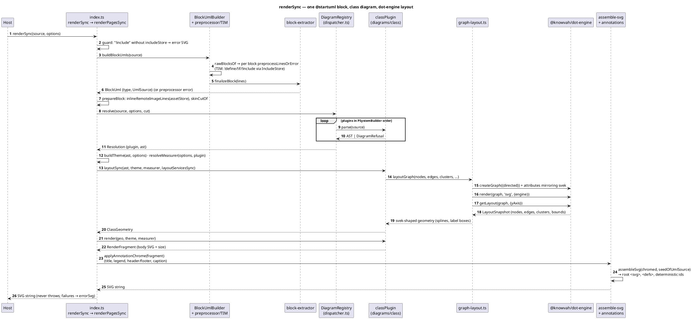
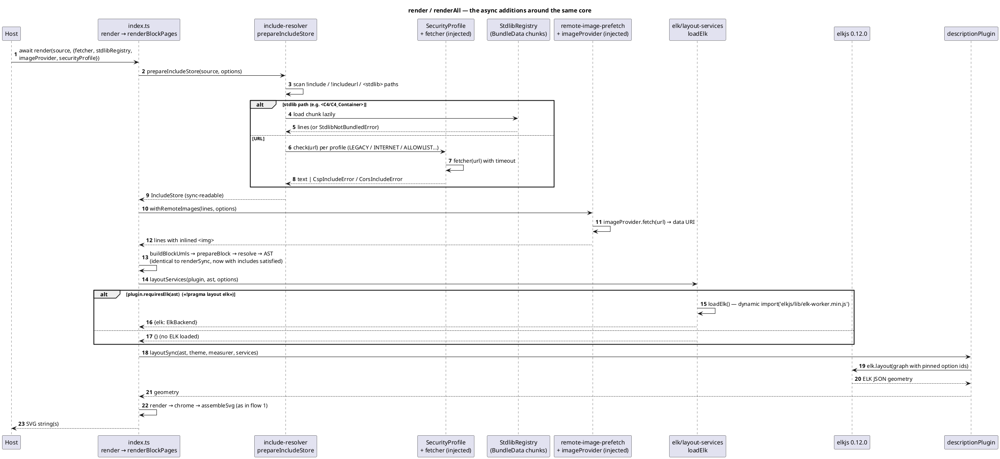
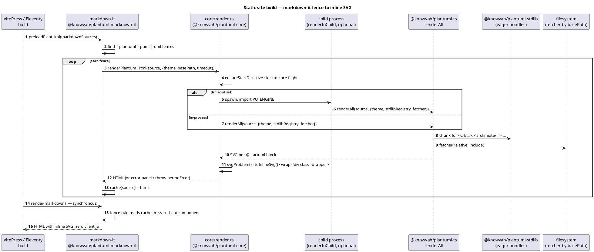
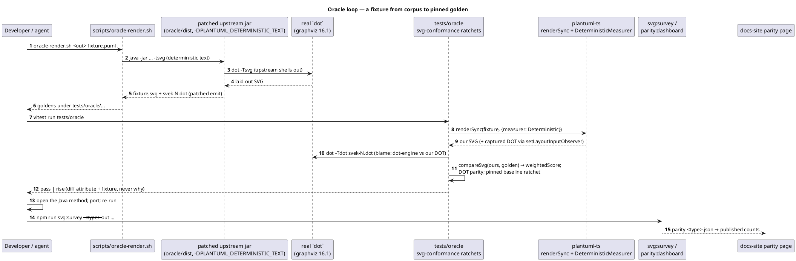

# Data Flows

Four flows: the synchronous library render (the hot path every host uses),
the asynchronous render that adds includes, stdlib, remote images and ELK,
the plantuml-plugins build-time path (the most common real-world caller),
and the oracle loop that defines "correct" for this project. File:line
references are to `main` at `d0d37ec18`.

## 1. `renderSync(source)` — the synchronous pipeline

Notes:
- The split into blocks happens **before** preprocessing
  (`BlockUmlBuilder.ts:133`), mirroring upstream `BlockUmlBuilder`; this is
  why a `!define` in one block cannot leak into the next.
- `resolveMeasurer` (`core/render-options.ts`) picks `jarMeasurer` for
  description diagrams and the Formula/Canvas fallback otherwise; tests and
  the oracle harness inject `DeterministicMeasurer`, which is why every
  text-derived number in a golden measures the port rather than a font.
- Sequence differs only inside the plugin: `getNbPages`/`renderPage`
  (`diagrams/sequence/index.ts:70-74`) yield one fragment per `newpage`,
  and `renderPagesSync` returns one SVG per page.
- Any exception at any step is caught at `index.ts:384` and turned into the
  jar-identical error page via `core/error/error-diagrams.ts`.

## 2. `render(source)` — async: includes, stdlib, remote images, ELK

Notes:
- `renderSync` cannot fetch: with an unsatisfied `!include` it returns an
  error SVG (`index.ts:360-366`); hosts pre-fill an `includeStore`
  (`prepareIncludeStore` is exported for exactly this).
- `renderAll` isolates includes per `@startuml` block
  (`index.ts:446-470`); `renderPages` keeps them shared.
- ELK in the sync path requires the host to pass `options.elk` (an
  already-loaded `ElkBackend`); otherwise `layoutServicesSync` throws
  `ELK_RENDER_SYNC_UNSUPPORTED`.

## 3. plantuml-plugins — build-time fence render (VitePress / Eleventy)

Notes:
- The two-phase shape (async preload, sync emit) exists because
  markdown-it's fence rule is synchronous while stdlib chunks load lazily.
- The browser path (`core/browser.ts` → `renderSync`) used by React, the
  web component, the VS Code `.puml` preview and JetBrains has **no**
  stdlib registry; unresolved `!include` becomes an error panel. The VS
  Code preview runs it in a `worker_threads` worker so the configured
  timeout can kill a runaway render.

## 4. The oracle loop — how fidelity is established

Notes:
- `scripts/oracle-render.sh` exists because a hand-typed `java -jar`
  without `-DPLANTUML_DETERMINISTIC_TEXT=true` measures the JVM font stack,
  not the port (`CLAUDE.md`).
- The ratchet's score is anti-monotone under element growth and blind to
  magnitude (see the project memory notes); a correct fix can raise it,
  so exit bars are written as "zero *unexplained* rises".
- Where upstream uses Smetana (json/yaml/hcl), no `svek-N.dot` exists and
  the DOT-parity branch is skipped by design.
