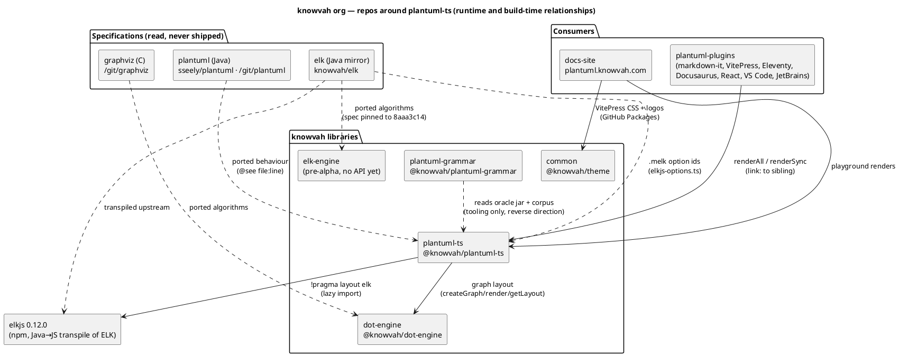

# Architecture Overview

Generated 2026-10-29 against `main` at `d0d37ec18` (PR #96,
`feat/data-diagram-conformance`, merged 2026-10-29). Supersedes the
2026-08-15/20 edition, which predates ~2,900 commits, the move from the
`sseely` to the `knowvah` org, and the mindmap/wbs/gantt/salt/ELK/data-diagram
engines.

## Index

| File | Contents |
|------|----------|
| [overview.md](overview.md) | this document — what the system does, how the repos relate, key flows, tech stack |
| [inventory.md](inventory.md) | one row per repo: language, runtime, framework, deps, entry point |
| [architecture.md](architecture.md) | system-level component diagrams: runtime dependencies and the reference/oracle graph |
| [components.md](components.md) | per-repo internal structure |
| [data-flow.md](data-flow.md) | sequence diagrams for the sync render, the async render, the plugin build-time flow, and the oracle loop |
| [tech-health.md](tech-health.md) | runtime/framework EOL and CVE status per repo, with actions |

## What the system does

**plantuml-ts** (`@knowvah/plantuml-ts`) is a faithful TypeScript port of
PlantUML. It takes PlantUML source text and returns an SVG **string**,
synchronously, with no server, DOM, canvas or Java at runtime, so it runs
unchanged in a browser, a Node build step, a VS Code extension host or a
JetBrains JCEF panel. The deliverable is fidelity to the upstream Java
implementation's accumulated behaviour — arrowheads, label placement,
skinparam/style resolution, layout quirks — measured against SVG and DOT
produced by a pinned, patched upstream jar.

```
@startuml
Alice -> Bob : hello
@enduml
```
→ `renderSync(src)` → `<svg …>…</svg>`

## How the repos relate



- **plantuml-ts** owns block splitting, the TIM preprocessor, diagram-type
  dispatch, 24 diagram engines, theme/skinparam/style resolution, text
  measurement, document chrome and SVG assembly. It owns layout for every
  non-graph diagram (sequence, activity, gantt, mindmap, wbs, salt, …).
- **dot-engine** is the layout engine for the graph-shaped diagrams (class,
  description/component/deployment/usecase/object, state) and the
  Smetana-replacement for json/yaml/hcl (ruling 2026-08-09: one layout
  engine, never Smetana). It is consumed as a pinned npm tarball (2.4.0;
  upstream is at v2.7.1) through a single seam, `src/core/graph-layout.ts`.
- **elkjs** is upstream's second engine (`!pragma layout elk`), reached only
  from `src/core/elk/load-elk.ts` (an architecture test enforces that
  boundary) and only for class and description diagrams.
- **elk** (Java mirror) is the specification for both elkjs's option ids
  and for **elk-engine**, a pure-TS ELK port that is not yet consumable and
  has no stated plan to replace elkjs in plantuml-ts.
- **plantuml-plugins** is the integration layer: one `core` package wraps
  `renderAll` (Node, with stdlib bundles and a filesystem fetcher) and
  `renderSync` (browser), and thin adapters bind it to each host. Nothing
  is published yet; it links to the sibling checkout.
- **common** publishes `@knowvah/theme`, consumed only by the docs sites.
- **plantuml-grammar** is a sibling tool, not a dependency: it extracts the
  command grammar from the same pinned jar plantuml-ts uses as its oracle,
  and ships a TextMate grammar + TS engine for editors. plantuml-ts has its
  own hand-ported parsers and does not import it.

### Referenced but not in the org

| Reference | Where | Role |
|-----------|-------|------|
| `sseely/plantuml` (upstream Java, fork under the user's personal account) | `CLAUDE.md`, every `@see` | canonical behavioural spec; `~/git/plantuml` at 1.2026.8beta1 |
| Graphviz C source | `CLAUDE.md` (`~/git/graphviz/lib/dotgen/`) | spec for dot-engine; read directly when a layout number needs explaining |
| `pdiff` corpus (`~/git/pdiff`, 5,600+ `.puml`) | `scripts/populate-corpus.py` | the work queue; one fixture per upstream issue |
| `plantuml-stdlib` (`~/git/plantuml-stdlib`) | `scripts/vendor-stdlib.ts`, `.github/actions/vendored-stdlib` | source of the vendored stdlib assets → `@knowvah/plantuml-stdlib*` (built **in this repo**, not separate repos) |
| `eclipse-elk/elk-models` | elk-engine `NOTICE.md` | ELK test corpus for elk-engine's oracle |
| GitHub Packages (`npm.pkg.github.com`) | `.npmrc`, `ci.yml` | `@knowvah/theme` only; everything else resolves from npmjs |

## Key data flows

1. **Synchronous render** (`renderSync`): split blocks → preprocess (TIM,
   includes from an injected store) → type the block → ordered plugin
   `parse()` until one accepts → build theme + pick measurer →
   `plugin.layoutSync()` (dot-engine / ELK / own) → per-page render →
   annotation chrome → `assembleSvg` → string. Never throws; any failure
   becomes an error-page SVG that mirrors the jar's.
2. **Asynchronous render** (`render`/`renderAll`): identical core, preceded
   by `prepareIncludeStore` (fetches `!include` URLs and stdlib chunks
   through the security profile), `withRemoteImages` (image provider), and
   `loadElk()` only when the diagram asks for ELK.
3. **Plugin build-time render** (plantuml-plugins): markdown-it fence →
   async pre-render into a cache via `core.renderPlantUmlHtml` →
   plantuml-ts `renderAll` (eager stdlib registry, FS fetcher, optional
   child-process timeout) → SVG validation/inlining → synchronous fence
   emit.
4. **Oracle loop** (how fidelity is measured): `scripts/oracle-render.sh`
   runs the patched jar with deterministic text to produce `svek-N.dot` and
   SVG goldens; `tests/oracle` compares our DOT input and SVG output to
   them; `svg:survey` and `parity:dashboard` publish the per-type score to
   the docs site.

Full sequence diagrams: [data-flow.md](data-flow.md).

## Tech stack summary

| Repo | Language | Runtime | Framework | Database | External deps |
|------|----------|---------|-----------|----------|---------------|
| plantuml-ts | TypeScript 6.0.3 | Node ≥26 / browser | Vite 8, Vitest 5, VitePress 1 | — | dot-engine 2.4.0, elkjs 0.12.0, katex 0.19, pako 3, xmldom 0.9.12; dev: Graphviz 16.1, OpenJDK 21 (oracle), Playwright |
| dot-engine | TypeScript | Node ≥22 / browser | esbuild, peggy, Vitest 4 | — | none at runtime; dev: `@hpcc-js/wasm-graphviz` oracle |
| plantuml-plugins | TypeScript 5.9, Kotlin 2.4 | Node ≥22, VS Code ^1.125, JCEF | pnpm, tsup, Vitest 4, IntelliJ Platform Gradle 2.18 | — | plantuml-ts + stdlib (link), markdown-it 15, React 19 |
| common | TypeScript, CSS | Node 22 | tsup, Vitest 5 | — | @heroicons/react |
| plantuml-grammar | Python 3.11–3.13, Java 21, TypeScript 6 | CPython, JVM, Node ≥26 | uv/pytest, Vitest 5, semantic-release | — | PlantUML jar (pinned), vscode-textmate |
| elk-engine | TypeScript 7.0.2 | Node ≥22 / browser | esbuild, Vitest 5 | — | none at runtime; dev: ELK Java oracle |
| elk (mirror) | Java 17 | JVM | Maven Tycho 4.0.12 | — | Guava, Xtext, EMF |

Version health and CVEs: [tech-health.md](tech-health.md).

## Observations worth acting on

- `@knowvah/dot-engine` is pinned at 2.4.0 while upstream tagged v2.7.1 on
  2026-10-27; a 2.6.10 bump branch (`chore/dot-engine-2-6-10`) is parked.
- plantuml-plugins `README.md:63` clones `sseely/plantuml-ts`; the repo now
  lives at `knowvah/plantuml-ts`.
- `vite.config.ts:44` still externalises `jsonc-parser`, which is no longer a
  dependency (`src/diagrams/json/JsonParser.ts:4` says it was replaced).
- elk-engine and plantuml-grammar are both org siblings with no code
  relationship to plantuml-ts today; neither is a dependency to document
  as such until one is wired in.
