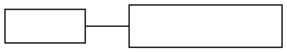

# Flat adjacent unlabelled edge (no port): endpoints differ by 0.1-0.3 px

**Impact:** `unknown/zodela-36-sica712` (a note connector: rect `x` 121.8 vs
the jar's 122.03, width 252.738 vs 253) and `usecase/cimare-47-deke334` (4
invisible edges, so the fixture is still conformant). Engine:
`@knowvah/dot-engine` 2.4.0 vs real `dot` 16.1.0 (homebrew). Found by
plantuml-ts mission `component-divergence-drive`, task T0b (ledger row U1),
re-run by the orchestrator 2026-10-15.

**Finding.** A single flat (same-rank via `minlen=0`) edge between two
adjacent nodes, with no port and no label. Node positions are identical; only
the edge's spline differs: dot-engine starts it 0.25 px earlier and ends it
0.2 px later, and the inner control points are spaced differently. Close to,
but distinct from, issue 30 (needs a port on one of a parallel pair) and 24
(both marked fixed).

## Repro



`dot -Tdot` (16.1.0), the `pos` values:

```
31.769,17
159.77,17
64.019,17 75.489,17 86.959,17 98.429,17
```

`render(parse(src), 'dot')` (dot-engine 2.4.0):

```
31.769,17
159.77,17
63.769,17 75.394,17 87.019,17 98.644,17
```

Re-run: `/opt/homebrew/bin/dot -Tdot repro.dot` against
`DE.render(DE.parse(src), 'dot')` with `DE` = `@knowvah/dot-engine/dist/index.js`.

## Suspected graphviz C source

`lib/dotgen/dotsplines.c` flat-edge path for adjacent nodes
(`make_flat_adj_edges`, single-edge branch without ports, which calls
`makeSimpleFlat`) and the endpoint clipping in `lib/common/splines.c`
(`clip_and_install`). Confidence: LOW — not traced into dot-engine. The native
start point 64.019 is 0.48 px outside the tail node's right side (31.769 +
31.77); dot-engine's 63.769 is 0.23 px outside, which points at the endpoint
clip or the `makeSimpleFlat` box rather than node placement.
