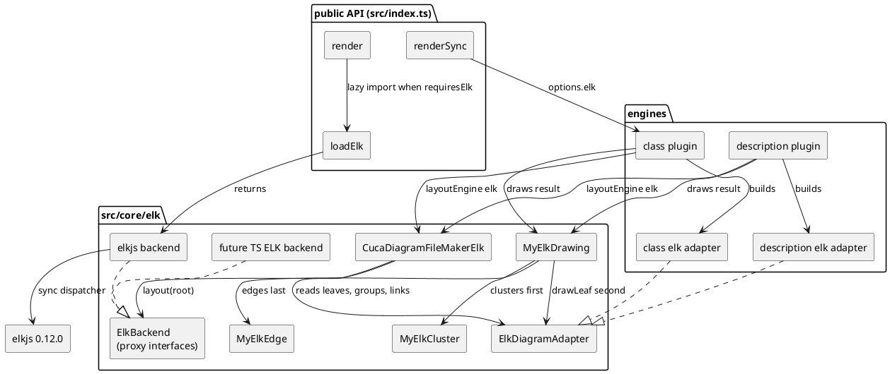

# Component map: the ELK path (D2, D13)

What cdd8 adds and where it touches existing components. The backend is the swap
point: a future TypeScript ELK port replaces the elkjs adapter and nothing else.

