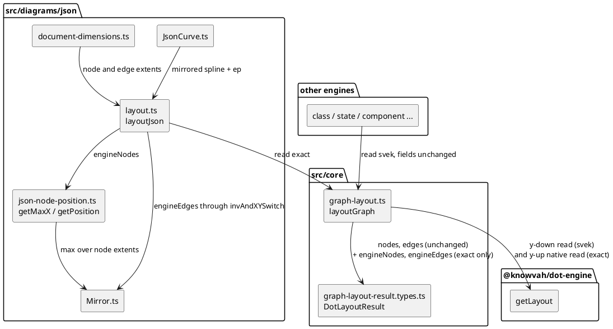

# Component map — json family node/edge placement after the mission

Proposed state. T2a adds the engine-frame read to core; T3a moves json's
placement onto the jar's `getPosition` + `Mirror` arithmetic. Every other
engine keeps reading the unchanged `nodes`/`edges` fields.

