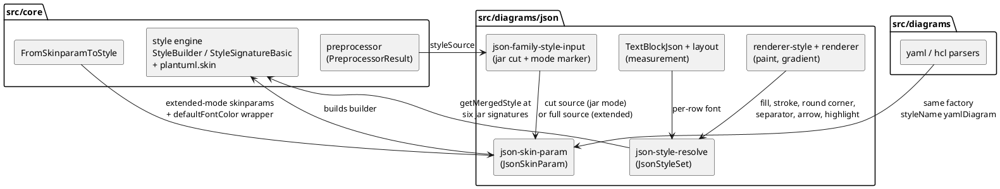

# Component map — json family style resolution after the mission

Components the mission touches, and how style data flows between them. Old
path (the `StyleMap` projection) is retired in batch 3.

