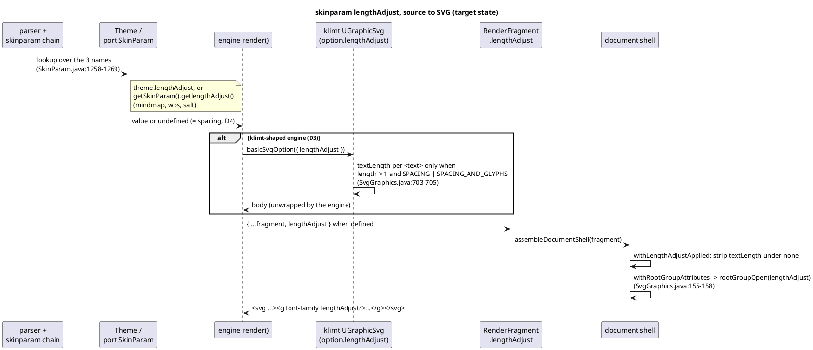

# lad — data flow

One value, three carriers. The diagram shows the target (post-lad) path of
`skinparam lengthAdjust` for the two engine shapes; the jar lines each hop
mirrors are in the notes.

The four re-routed engines (D2) enter this diagram at `RenderFragment` for
the first time: today they reach the generic `svgRoot`, which has no
`lengthAdjust` input and writes no `data-diagram-type`.
