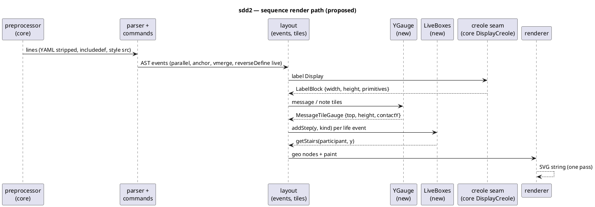

# Data flow — sequence render after sdd2

What changes: the layout stage gains the upstream teoz structures (D3) and
labels are measured and drawn through core creole (D5). Parse and render
keep their seams.

## Where each batch lands

| Batch | Stage |
|---|---|
| 1 | parser + commands |
| 2 | layout: YGauge, note tiles, LiveBoxes, LinkAnchor draw pass |
| 3, 4, 5 | layout: width, frames, labels, participants |
| 6 | creole seam |
| 7 | renderer (message drawing, chrome, banner) |
| 8 | preprocessor |
