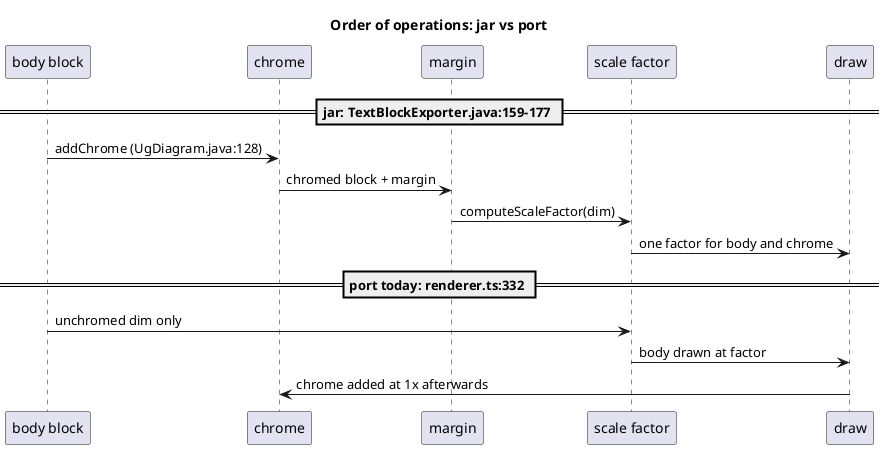

# T3a diagnosis: export scale vs chrome composition

Task T3a, mission sdd3, branch `sdd3/T3a` off `9ef8e1c4e`. Diagnosis only: no
`src/` change is committed. Java paths are under
`~/git/plantuml/src/main/java/net/sourceforge/plantuml/`; port paths are
relative to the repo root. Measurements ran at b2-close (`cls.json` equals
`measurements/b2-classify.json` row for row: 0 of 1143 rows moved).

## Verdict

One mechanism explains all 15 target rows, plus one sub-case and one design
constraint. All three are proven by a scratch in-`src/` prototype (reverted)
that takes **all 15 rows to zero diffs through the ratchet path**
(`diff-one.mts`) and **classify 2774 -> 1644** (15 to zero, 1 riser with a
known cause, section "Adjacent findings" A1).

| ID | Mechanism | Rows |
|---|---|---|
| M1 | The export scale is resolved from, and applied to, the UNCHROMED body; chrome is composed afterwards at 1x | all 15 |
| M2 | (sub-case of M1) for `scale W*H` / `W height` / `W width` the factor is computed from the wrong dimension | javedu, kepuxa, nabesa, vikelu (bocudo, jesari are width-specs whose width chrome does not change: M1 only) |
| M3 | (constraint on the fix, not a baseline divergence) a scale pass over already-3-decimal numbers double-rounds `textLength`; scaled documents must be drawn with numbers deferred | 12 of the 15 would keep residual diffs without it |

## Java read (quoted)

- `UgDiagram.java:123-137` (`getExporter`): `TextBlock result = getTextBlock(index, fileFormatOption);`
  then `result = addChrome(index, result);` (`:128`), then
  `result = TextBlockUtils.addBackcolor(result, backColor);` (`:130-132`), then
  `TextBlockExporter.builder(result, effectiveFormat, isHandwritten())` with
  `builder.styled((TitledDiagram) this)` for a titled diagram (`:138-139`).
  `SequenceDiagram extends TitledDiagram` (`SequenceDiagram.java:84`),
  `TitledDiagram extends UgDiagram` (`TitledDiagram.java:84`), so sequence
  takes the `styled` arm; `addChrome` is `TitledDiagram.java:470-477`:
  `DiagramChromeFactory.create(result, this, this.getSkinParam(), getWarnings(), title)`.
- `DiagramChromeFactory.java:123-135` (`create`): `addWarnings`,
  `decorateWithFrame`, `addLegend`, `addTitle`, `addCaption`,
  `addHeaderAndFooter`, in that order, around the RAW block.
- `teoz/SequenceDiagramFileMakerTeoz.java:137-138,163`: the block draws at
  `ug.apply(new UTranslate(5, 5))` and reports
  `new XDimension2D(totalWidth + 10, totalHeight + 10)`.
- `core/TextBlockExporter.java:159-177` (`exportTo`):
  `final XDimension2D dim = calculateFinalDimension();` (`:160`),
  `final double scaleFactor = computeScaleFactor(dim);` (`:165`),
  `UGraphic ug = createUGraphic(dim, scaleFactor);` (`:169`),
  `ug = ug.apply(new UTranslate(margin.getLeft(), margin.getTop()));` (`:173`),
  `textBlock.drawU(ug);` (`:177`).
- `core/TextBlockExporter.java:199-209`: `calculateFinalDimension` is
  `textBlock.calculateDimension(stringBounder)` plus the four margin sides
  (`:200-202`); `computeScaleFactor(dim)` is
  `final int dpi = skinParam == null ? 96 : skinParam.getDpi();`
  `final double fromScale = scale == null ? 1 : scale.getScale(dim.getWidth(), dim.getHeight());`
  `return fromScale * dpi / 96.0;` (`:206-208`). `textBlock` is the CHROMED block.
- `core/TextBlockExporter.java:510-516`: margin is the merged
  `{root, document}` style's `Margin` when present, else `getDefaultMargins()`;
  `SequenceDiagram.java:629-633` returns `same(5)` under teoz.
- Scale strategies, all reading the dimension they are handed:
  `ScaleSimple.java:46-48` (`return scale;`), `ScaleWidth.java:46-48`
  (`maxWidth / width`), `ScaleHeight.java:46-48` (`maxHeight / height`),
  `ScaleWidthAndHeight.java:48-55` (`Math.min(maxWidth / width, maxHeight / height)`),
  clamped by `ScaleProtected.java:42-51` (`<= 0` gives 1, `> 4` gives 4).
  `SkinParam.java:649-656` `getDpi()` (default 96).
- `klimt/drawing/svg/SvgGraphics.java`: `ensureVisible` is unscaled
  (`:129-135`, `maxX = (int) (x + 1)`), seeded with the exporter dimension
  (`:143`); `format(xx)` multiplies by `option.getScale()` and rounds ONCE
  (`:466-475`); the root writes `maxXscaled = (int) (maxX * option.getScale())`
  for `style`/`viewBox` and `format(maxX)` for `width`/`height`
  (`:800-815`); the background rect is resized with `format(maxX)` (`:819-821`).
- `command/CommandRotate.java:64-70`: `"Accepted but ignored: 'rotate' has no
  effect"`, `executeArg` returns `ok()`.

## M1: scale before chrome

- **Mechanism.** The port resolves the export factor from the unchromed body
  (`geo.totalWidth/totalHeight`), draws the body already multiplied by it, and
  composes title/header/footer/legend afterwards at 1x on that scaled canvas.
  The jar chromes first, derives the factor from the chromed + margined
  dimension, and draws block and chrome through one scaled `UGraphic`.
- **Origin (port).**
  `src/diagrams/sequence/renderer.ts:332`
  (`const k = resolveScaleFactor(geo.scale, geo.totalWidth, geo.totalHeight, theme.dpi)`),
  `:333-334` (`scaleSequenceGeometry`/`scaleSequenceTheme`), `:406-407`
  (`canvasOf(geo, k)`, `preChromeDims(scaledGeo, k)`);
  `src/diagrams/sequence/renderer-document.ts:82`
  (`if (k !== 1) return {};` withholds the margin-less block, so chrome sees the
  final scaled canvas); `src/diagrams/sequence/sequence-warnings.ts:69` (a
  `scale`d page has no declared margin, so the warning banner is skipped);
  composition at `src/index.ts:153-187` -> `src/core/annotations/chrome-export.ts:36`
  -> `src/core/annotations/chrome.ts:361-414`, all at 1x.
- **Upstream.** `TextBlockExporter.java:160,165,169,173,177,200-208` and
  `UgDiagram.java:128` above: chrome is part of the block the factor is
  computed from.
- **Causal chain.** (1) `k` comes from the unchromed dim, so
  `scaleSequenceGeometry` multiplies only body numbers. (2) `applyChrome`
  receives `preChromeWidth` undefined, takes `fragment.width/height` (the
  scaled canvas) as the block and adds the title at its unscaled size. (3)
  Closed form, verified on the rows: ours canvas height is
  `trunc(H + 1) * k + chromeH_1x`, the jar's is `trunc(H + chromeH_1x + 1) * k`
  (`regate-07-rore899`: `124 * 4 + 46 = 542` vs `(123 + 46 + 1) * 4 = 680`;
  `baketu-62-cumu838`: `274 * 4.1667 + 100.692 = 1242.359` vs
  `374 * 4.1667 = 1558.333`; `suzumi-85-nuzo693`: `124 * 0.25 + 46 = 77` vs
  `170 * 0.25 = 42.5`). (4) Chrome text keeps `font-size`/`textLength`/`x`/`y`
  and sprite `width`/`height` at 1x; the body sits `chromeH_1x` below where
  `chromeH_1x * k` would put it, and is centred in a chrome box of the wrong
  scale (`x` shifts).
- **Attribute assignment** (base diffs of each row classified by region; every
  diff falls in one of these classes; counts are per class over the row):

  | Class | Attributes | Why |
  |---|---|---|
  | canvas | `svg/@width`, `@height`, `@viewBox[2]`, `@viewBox[3]` | `trunc(H+1)*k + chrome` vs `trunc(dim+1)*factor` |
  | chrome (title/header/footer) | `@font-size`, `@textLength`, `@x`, `@y`; title sprite `<image>` `@width/@height/@x/@y` | chrome never multiplied (baketu/tumuke: the 3 sprite images, `chrome:title @width x3, @height x3`, confirm "title and sprite stay 1x") |
  | body, offset only | `@y`, `@y1`, `@y2`, `@points`, `@cy`, `@d` (baketu/tumuke); `@x`, `@x1`, `@x2` (baketu, suzumi: chrome wider than the body re-centres it) | body translated by 1x chrome instead of `chrome * k` |
  | body, size/paint | `@font-size`, `@width`, `@height`, `@rx`, `@ry`, `@stroke-width`, `@stroke-dasharray`, `@textLength` | only M2 rows (wrong factor) |

  Per-row region counts (base): baketu/tumuke 168 = body `d`x40 `points`x32 `x`x23
  `y`x23 `x1/x2/y1/y2`x24, canvas 4, title 22; dolefo 164 = body `y1/y2`x102
  `y`x38 `points`x16 `cy`x2, canvas 2, title 4; jujigi 58 = body `y`x12
  `points`x12 `y1/y2`x14, canvas 2, header/title/footer 18; suzumi 54 = body 42
  (`x`x11 `y`x11 `x1/x2/y1/y2`x12 `points`x8), canvas 4, title 4, footer 4 (full
  lists: `diff-one.mts <slug>`, region counts: scratch `regions.mts`); bocudo/jesari/regate 31 and mozoza/zavacu/zunile 27 =
  body `y`x11 `y1/y2`x6 `points`x4 (21), canvas 2, chrome 8 (title 4 + footer 4;
  the 27-row family has title only: 4).
- **Ruled out** (evidence):
  - `rotate` is a variable: no. `CommandRotate.java:64-70` ignores it and the
    port parses it to nothing; twins have identical diffs
    (baketu = tumuke = 168 attributes, jesari = bocudo = 31).
  - `skinparam dpi` is a different mechanism from `scale`: no. dpi-only
    (baketu) is the same code path: `computeScaleFactor` multiplies
    `dpi / 96.0` after the strategy (`TextBlockExporter.java:208`);
    `resolveScaleFactor` already does, and the prototype zeroes baketu with the
    same `finalize` as the `scale N` rows.
  - Layout divergence (geometry before scale): no. The prototype reuses the
    same `layoutSequence` output; 15 rows go to zero, so the unscaled geometry
    was already right.
  - Margin (T2d `withExporterMargin`) as a cause: no. None of the 15 declares a
    `document { Margin }`. Composition with a style margin was tested on fresh
    jar renders (below): 0 diffs.
  - Newpage (dolefo): page 1 only is compared; zero under the prototype.
  - `TextBlockUtils.addBackcolor` altering the dimension: no.
    `TextBlockUtils.java:152-175` delegates `calculateDimension` to the
    wrapped block.
  - A drawn-extent term (ARCTO `ensureVisible`) in the 15: no. The prototype
    canvas is `trunc(exportedDimension + 1) * factor` with no drawn-extent term
    and all 15 are zero.
- **Rows.** All 15 (table below).
- **Proposed write-set for T3b.** See "T3b write-set".
- **Confidence.** HIGH. Mechanism stated, closed-form identity on 3 rows,
  counterfactual prototype 15/15 zero via the ratchet path, 4 extra
  jar-rendered stress documents.

## M2: factor computed from the unchromed dimension

- **Mechanism.** For specs that read the dimension, M1's wrong dimension gives
  a wrong FACTOR, so every body number is off, not only the chrome.
- **Origin.** `renderer.ts:332` (same line); the spec's dimension is
  `geo.totalWidth x geo.totalHeight` = 113.388 x 123 where the jar's is the
  chromed 113.388 x 169.
- **Upstream.** `ScaleWidthAndHeight.java:48-55`
  (`Math.min(maxWidth / width, maxHeight / height)`), `ScaleHeight.java:46-48`,
  `ScaleWidth.java:46-48`, fed `calculateFinalDimension()` (`:160,165`).
- **Causal chain / measured** (`table.txt`, scratch):

  | slug | spec | k ours (unchromed) | k jar (chromed) | canvas ours / jar |
  |---|---|---|---|---|
  | javedu-98-pibi325 | `scale 100*50` | 0.4065 | 0.2959 | 46.341x96.407 / 33.728x50.296 |
  | kepuxa-88-juxu405 | `scale 100x30` | 0.2439 | 0.1775 | 44.275x76.244 / 20.237x30.178 |
  | nabesa-52-nufu501 | `scale 300*200` | 1.6260 | 1.1834 | 185.366x247.626 / 134.911x201.183 |
  | vikelu-53-faga789 | `scale 100 height` | 0.8130 | 0.5917 | 92.683x146.813 / 67.456x100.592 |
  | bocudo-94-jode371, jesari-34-mudu065 | `scale 100 width` | 0.8819 | 0.8819 | width equal (chrome narrower than body); height differs by M1 only |

  The jar column is exactly `min(100/113.388, 50/169) = 0.2959`:
  `170 * 0.2959 = 50.296`, the jar's height. Specs that do not read the
  dimension (`scale N`, `scale 1/4`, `dpi`) have k ours = k jar and show M1
  only (the other 9 rows).
- **Ruled out.** A clamp difference (`ScaleProtected.java:42-51`): both sides
  clamp at 4 and fall back to 1; no row is clamped. `resolveScaleFactor`
  (`src/core/scale-command.ts:198-224`) is already the Java arithmetic: the
  prototype feeds it the right dimension and nothing else changes.
- **Rows.** javedu, kepuxa, nabesa, vikelu (body size/paint diffs on top of M1).
- **Proposed write-set.** Same as M1 (no separate fix).
- **Confidence.** HIGH.

## M3: format-once constraint (what the fix must do)

- **Mechanism.** `SvgGraphics#format` multiplies by the scale and rounds once
  (`SvgGraphics.java:466-475`). The port's string bodies are already rounded to
  3 decimals at emission; a scale pass after that double-rounds. `compare.ts`
  treats `textLength` as a string (not in `NUMERIC_ATTRS`), so a 0.002 drift is
  a diff.
- **Origin of the hazard.** `src/core/TextBlockExporter.ts:129`
  (`scaleToken` multiplies an already-rounded token; its own doc comment
  journals the tradeoff) and any consumer that scales a formatted body. The
  port already has the cure: `src/core/svg-format.ts:136` `withDeferredFormat`
  plus `RenderFragment.numbersDeferred` (`src/core/dispatcher-types.ts:210`),
  used by activity (`src/diagrams/activity/renderer.ts:432-435`) and
  description (`src/diagrams/description/index.ts:141-156`), and the scale pass
  `src/core/assemble-svg-activity.ts:140` `scaleActivityBody`, which
  already covers sequence's vocabulary (`line` `x1..y2`, `ellipse` `cx/cy`,
  `stroke-dasharray`, path `A` arcs, `points`).
- **Upstream.** `SvgGraphics.java:466-475`; the scale is the `UGraphic`'s
  (`TextBlockExporter.java:165-169`).
- **Causal chain / control experiment.** Same prototype but the body drawn
  WITHOUT deferral (regex scale over formatted numbers, the mindmap
  `scaleFragmentBody` shape): baketu 11, tumuke 11, dolefo 18, jujigi 6,
  regate 4, suzumi 2, bocudo 2, jesari 2, zavacu 2, vikelu 1, mozoza 1,
  zunile 1, javedu/kepuxa/nabesa 0. Every residual is `@textLength`
  (all 29 residual attributes on baketu and dolefo are `@textLength`, e.g.
  `99.752` vs jar `99.75` on regate). With deferral: 0 on all 15.
- **Ruled out.** Routing sequence through `core/TextBlockExporter.ts#finalizeTitledDiagramFragment`
  (mindmap/wbs/salt): see "Contradicted lead".
- **Rows.** The 12 above; not a baseline diff of any row (it is exposed only by
  a correct M1 fix done the mindmap way).
- **Proposed write-set.** Same as M1 (the deferral is part of the fix).
- **Confidence.** HIGH (control run).

## Per-row attribution

`ws` is `classify.mts` at b2-close; "proto" is the in-`src/` prototype through
the same ratchet path.

| slug | spec / dpi | chrome | mechanisms | ws | proto |
|---|---|---|---|---|---|
| baketu-62-cumu838 | dpi 400 | title + 3 sprites | M1 (+M3) | 168 | 0 |
| tumuke-16-xomo243 | dpi 400, `rotate` | title + 3 sprites | M1 (+M3) | 168 | 0 |
| dolefo-13-kovu702 | `scale 3` | title, 2 pages | M1 (+M3) | 164 | 0 |
| javedu-98-pibi325 | `scale 100*50`, `rotate` | title, footer | M1 + M2 | 94 | 0 |
| kepuxa-88-juxu405 | `scale 100x30` | title, footer | M1 + M2 | 94 | 0 |
| nabesa-52-nufu501 | `scale 300*200` | title, footer | M1 + M2 | 94 | 0 |
| vikelu-53-faga789 | `scale 100 height` | title, footer | M1 + M2 (+M3) | 94 | 0 |
| jujigi-41-zodo151 | `scale 1.2` | header, title, footer | M1 (+M3) | 58 | 0 |
| suzumi-85-nuzo693 | `scale 1/4` | title, footer | M1 (+M3) | 54 | 0 |
| bocudo-94-jode371 | `scale 100 width`, `rotate` | title, footer | M1 (+M3) | 31 | 0 |
| jesari-34-mudu065 | `scale 100 width` | title, footer | M1 (+M3) | 31 | 0 |
| regate-07-rore899 | `scale 4` | title, footer | M1 (+M3) | 31 | 0 |
| mozoza-90-biru865 | `scale 4`, Roboto | title | M1 (+M3) | 27 | 0 |
| zavacu-31-dola792 | `scale 4` | title | M1 (+M3) | 27 | 0 |
| zunile-23-zezi158 | `scale 4`, Roboto | title | M1 (+M3) | 27 | 0 |

Sum ws = 1162 of 2774. Full classify with the prototype: 2774 -> 1644, 15 to
zero (the 15 above), 15 fell (the same), 1 rose
(`gepuce-64-pivu656` 241 -> 273, A1).

## Drawn-extent fact (journal row 34)

`SvgGraphics#svgPath` calls
`ensureVisible(coord[5] + coord[0] + x + 2 * deltaShadow, coord[6] + coord[1] + y + 2 * deltaShadow)`
for every ARCTO segment (`SvgGraphics.java:849-854`), and `ensureVisible`
sets `maxX = (int) (x + 1)` (`:129-131`), all in UNSCALED coordinates (the
scale is applied only at `:466-475` and `:801-815`). The exported canvas is
therefore the DRAWN extent (`max(exporter dim, every ensureVisible)`), not the
layout extent. **None of the 15 targets carries the term**: the prototype
canvas is `trunc(exportedDimension + 1) * factor` and all 15 are zero.
`gebeki-18-muci858` (`scale 2`, `RoundCorner 40`, coloured `alt` top band)
carries it (batch 5): its residual under the prototype is unchanged at 2
(`svg/@width`, `viewBox[2]` 458 vs 460), so the term is orthogonal to this
route. Under the new route the renderer draws at 1x, so the drawn extent is
accumulated in the same unscaled space `SvgGraphics` uses and the batch-5 term
is added in `canvasOf` independent of `k`; no rewrite of M1's fix is needed.

## How T2d, `preChromeDims`, `canvasOf`, `sequenceExportedDimension` fold in

Verified by the prototype (4 stress documents plus 2 fresh jar renders, below).

| Piece | After the re-mirror |
|---|---|
| `withExporterMargin` (`renderer-document.ts:113`, T2d) | Stays. It is the exporter's `Margin` (`TextBlockExporter.java:510-516`) resolved BEFORE chrome and declared as `documentMargin`, which `documentMarginOf` (`core/document-margin.ts`) hands to `applyExportedChrome`. The `* k` terms and the `canvasOf(grown, k)` scaled branch become constant-1. Fresh jar renders: `scale 2` + `Margin 10` + `title T` = 248x358 and `dpi 200` + `Margin 2 7 11 3` + `footer F` = 237x314 are both 0 diffs; the pre-fix route gave 313 and 288 high. |
| `preChromeDims` (`renderer-document.ts:77-83`) | The `if (k !== 1) return {}` guard (`:82`) goes: the margin-less block is always declared, because the draw is always at k = 1. This is what lets chrome see the true block. |
| `canvasOf` (`renderer-document.ts:57-65`) | Only the `k === 1` branch is reached; the `scaledCanvas: true` branch (`:59-63`) is dead because the finalize sets `scaledCanvas`. |
| `sequenceExportedDimension` (`core/assemble-svg-sequence.ts:99-114`) | Exactly `calculateFinalDimension()`: chrome sets `exportedDimension` (`core/document-margin.ts:122-136`), else block + margin. It is the `dim` argument of `computeScaleFactor`; the prototype uses it unchanged. Its third branch (`width - SEQUENCE_ENSURE_VISIBLE_DELTA`, "a block left undeclared (a scaled document)") is unreachable once `preChromeDims` always declares. |
| `applyExportedChrome` (`core/annotations/chrome-export.ts:36`), `index.ts:153-187` | Unchanged. They already compose chrome around the margin-less block and re-apply the margin (`UgDiagram.java:128` then `TextBlockExporter.java:173,199-203`). |
| `scale-geo.ts` (`scaleSequenceGeometry`, `scaleSequenceTheme`, `scaleK` in 12 sequence renderer files) | Identity at k = 1 (`scale-geo.ts:373-375`). Dead scaling paths become a follow-on cleanup, not T3b: removing them rewrites 12 files for no output change. Their unit test (`scale-geo-paint.test.ts`) still passes. |
| `withSequenceWarningBanner` (`sequence-warnings.ts:63-71`) | The banner now participates on a scaled page (jar: `addWarnings` is the first chrome step, `DiagramChromeFactory.java:128`); `withWarningBanner` already honours `fragment.numbersDeferred` (`core/skinparam-warnings.ts:118`). See A1. |

## Contradicted lead (the Java wins)

The task spec expected T3b to "take the same `UgDiagram.ts`/`TextBlockExporter.ts`
route as mindmap/wbs/salt" and a write-set of `renderer.ts`, `scale-geo.ts`,
`src/index.ts`, `chrome-export.ts`, `assemble-svg-sequence.ts`. The Java order
is as the spec says (chrome, margin, factor, draw), but the file mapping does
not hold:

1. `src/core/UgDiagram.ts` is the NON-titled arm only (its own header: "its
   export path for the diagrams that are NOT a `TitledDiagram`", java
   `:140-145`); `exportTo` hard-codes `NO_SKIN_PARAM_DPI = 96` (`:56,131`) and
   has no chrome. A sequence diagram is a `TitledDiagram`
   (`UgDiagram.java:138-139`), so it cannot use that file.
2. `src/core/TextBlockExporter.ts#finalizeTitledDiagramFragment` (`:288`) throws
   without `exportMargin` (`:291`), shifts the margin itself (the sequence
   margin is baked into the layout and already handled by
   `applyExportedChrome`), and scales a body formatted at 3 decimals (M3:
   textLength double-rounding). It works for mindmap/wbs/salt because their
   body is drawn through klimt at the final scale (`drawBodyAt`); sequence's
   body is a string built by the renderer, like activity's.
3. The matching precedent is activity/description: `numbersDeferred` +
   `scaleActivityBody` + `scaleShadowFilterDefs`.
4. `src/index.ts`, `chrome-export.ts` and `scale-geo.ts` need no change.

## T3b write-set

Exactly the files the prototype touched, plus the tests it broke. `core` rows
are all-engine-gated.

| File | Change | Core |
|---|---|---|
| `src/diagrams/sequence/renderer.ts` | `renderPaginated` (`:327`): draw inside `withDeferredFormat(isExportScaled(geo.scale, theme.dpi), ...)`; stamp `numbersDeferred: true`, `scaleSpec: geo.scale`, `dpi: theme.dpi` on the fragment; `k = 1` (delete the `resolveScaleFactor` import `:33` and call `:332`). Split `renderPaginated` into a wrapper and `drawPaginated` (file is 422 lines, cap 500). | no |
| `src/diagrams/sequence/renderer-document.ts` | delete `if (k !== 1) return {};` (`:82`); (optional) drop the now-constant `k` parameters | no |
| `src/core/assemble-svg-sequence.ts` | new `finalizeSequenceFragment`: `finalizeSequenceBody` first (background and border rects spliced BEFORE the scale, as `finalizeActivityFragment` does, `SvgGraphics.java:819-821`), then `factor = resolveScaleFactor(scaleSpec, exportedDim.w, exportedDim.h, dpi)` (`TextBlockExporter.java:205-209`), `scaleActivityBody`, `scaleShadowFilterDefs`, `scaledCanvas: true`, `width/height = trunc(w|h) * factor`; delete `sequenceExportedDimension`'s unreachable third branch | **yes** |
| `src/core/assemble-svg.ts` | `:329-330` dispatch to `finalizeSequenceFragment` (2 lines; file is 425 lines) | **yes** |
| `src/diagrams/sequence/sequence-warnings.ts` | none in the prototype (banner now applies on scaled pages); update the `:58-62` doc comment. Interim guard only if A1 is not fixed first. | no |
| tests | rewrite the 4 tests below; new unit tests quoting `TextBlockExporter.java:205-209` | no |

**`src/core/svg.ts` is NOT in the proposed write-set.** T3c (`svg.ts`
`linkWrap`) is file-disjoint from T3b: no reordering needed. Also NOT in it:
`src/index.ts`, `chrome-export.ts`, `chrome.ts`, `scale-geo.ts`,
`core/TextBlockExporter.ts`, `core/UgDiagram.ts`, the harness
`render-fixture-sequence.ts` (it calls `renderSequence` + `applyExportedChrome` +
`assembleSvg`, so it follows production with no edit; `prod == harness` verified
byte-for-byte on baketu, javedu and jujigi before the change).

### Prototype evidence for T3b's gates

- **15 targets**: all 0 through `diff-one.mts`; `classify.mts` 2774 -> 1644.
- **Pins (stop 6)**: of the 37 sequence fixtures that declare `scale` or `dpi`,
  the 22 pinned ones (cabedu, caxuke, dazuzi, juputo, junide, kitevo, kixani,
  kofuti, luleji, luxiti, netanu, pixifi, rudola, ruxazu, tatesu, totebu,
  vacigu, xalaxi, ...) are BYTE-equal before and after; only the 15 targets and
  `gepuce` change; `gebeki`, `raxeca`, `sulipe` are unchanged. The ratchet
  `sequence.golden.ratchet.test.ts` (all 1042 pins) passed.
- **Stress** (fresh jar renders, all participant kinds, frames, divider, delay,
  ref, activation, destroy, autonumber, title/header/footer/legend):
  `scale 1.7`: 403 -> 0; `dpi 150` + `scale 100 width`: 403 -> 0; `dpi 72`:
  403 -> 0; `scale 0.6` + shadowing + roundcorner 20: 409 -> 2 (the legend
  `rx`, A3, unrelated: it reproduces unscaled). A document with background,
  border, `scale 1.2`, title and note: 0 vs the jar.
- **Tests the prototype broke (6)**, all expected fallout, none a regression:
  `tests/unit/sequence/command-link-anchor.test.ts` (`scales every length at
  emission`, `:117-122`), `tests/unit/sequence/else-tile.test.ts` (`scales an
  else tile at emission under scale 2`, `:76-86`),
  `tests/unit/sequence/sequence-layout-life-event.test.ts` (`scales the corner,
  the size and the stroke`, `:232`), `tests/unit/sequence/renderer-document-margin.test.ts`
  (`a scaled page moves the body and canvas by the margin delta times the
  scale`, `:104-114`: it asserts `scaledCanvas` and `preChromeWidth` undefined
  straight off `renderSequence`; both now come from the finalize) all call
  `renderSequence` and read scaled numbers; re-express them through
  `assembleSvg(renderSequence(...))` with the same expected numbers.
  `sequence.diff-baseline.ratchet.test.ts` fails twice: `gepuce` (A1) and
  `rise detection fires against a REAL fixture` (`:385-391`,
  `baselineFixtures[0]` is `baketu-62-cumu838`, which is now 0): the second
  resolves itself when the orchestrator re-pins baketu to `pinned`
  (`baselineFixtures[0]` moves on) and is not a T3b write.
- **All-engine**: both core edits are keyed on `diagramType === 'SEQUENCE'`
  (`assemble-svg.ts:329-330`) and on `numbersDeferred`, which only sequence
  sets on this path; a non-sequence row can move only through an embedded
  sequence render. The survey was NOT run (T3a is read-only); T3b runs
  `chain.sh` and `svg-hashes.mts`.

## Adjacent findings (not target-row mechanisms)

- **A1: gepuce rise (241 -> 273, 21 -> 26 diffs).** Mechanism: the port emits
  the `skinparam handwritten` deprecation banner for the brace form
  `skinparam { handwritten true }`; upstream's `CommandSkinParamMultilines`
  does not (no Warning reference in `command/CommandSkinParamMultilines.java`;
  `CommandSkinParam.java:88-99` is the single-line form only). Origin
  `src/core/skinparam-warnings.ts:57-69` (documented there as a known
  limitation: "a `skinparam { ... }` block entry warns too"). It was hidden
  because `sequence-warnings.ts:69` skipped the banner on every scaled page.
  Counterfactual: re-adding that skip (`|| fragment.numbersDeferred === true`)
  returns gepuce to exactly 21 diffs. No cached scaled jar SVG carries a
  banner (checked with `Please\Wuse` over all 37). Options for the
  orchestrator: (a) fix the brace form first (outside T3b's write-set: stop 1,
  needs the collector to keep the line form); (b) interim guard in
  `withSequenceWarningBanner`, journaled, which keeps the old, wrong mirror for
  a scaled page that has a REAL banner; (c) adopt the rise (the re-pin tool
  raises a pin silently, memory `repin-script-raises-preexisting-red-pin`; do
  not). Recommend (a), then the guard is unnecessary. Confidence HIGH.
- **A2: drawn-extent canvas (gebeki).** Above. Batch 5.
- **A3: legend `rx` ignores `skinparam roundcorner`.** `g[class=legend]` rect
  `rx` 7.5 vs jar 10 at `roundcorner 20`, also unscaled (`s5` reproduction).
  Origin is the legend chrome (`src/core/annotations/`), not scale. Not filed
  against any row; MEDIUM (one document, origin file not traced).

## Unexplained

None for the 15 targets: every base diff attribute is in a class above and
the prototype zeroes all 15 rows. Residual risks, each with the next
instrumentation:

- Klimt-drawn participant glyphs (`UGraphicSvg` seam) under deferral: covered
  by `netanu`, `ruxazu` (actors, pinned, byte-equal) and the stress documents
  (boundary, control, entity, database, collections, queue; 0 diffs). No further
  instrumentation unless a new participant kind is ported.
- Fractional-scale background/border rect width (`SvgGraphics.java:819-821`
  writes `format(maxX)`): matched by splicing the rect before the scale
  (0 diffs on the `scale 1.2` document); `maybeSequenceBackgroundRect` still
  truncates its own width, which is right at the unscaled `maxX`.
- All-engine effect of the two core edits: not measured here (above).

## Instrumentation and reproduction

Scratch only, under the session scratchpad (`.../scratchpad/t3a/`): `proto.mts`
(harness-level counterfactual: render at k = 1 deferred, chrome, factor from
`exportedDimension`, `scaleActivityBody`), `runall.mts`, `table.mts`,
`regions.mts`, `bytes.mts`, `margin.mts`, `cmp2.mts`; the in-`src/` prototype
diff is `proto-src.diff` (108 lines: `renderer.ts`, `renderer-document.ts`,
`assemble-svg-sequence.ts`, `assemble-svg.ts`), applied, measured and reverted.
Oracle renders only via `scripts/oracle-render.sh`.
