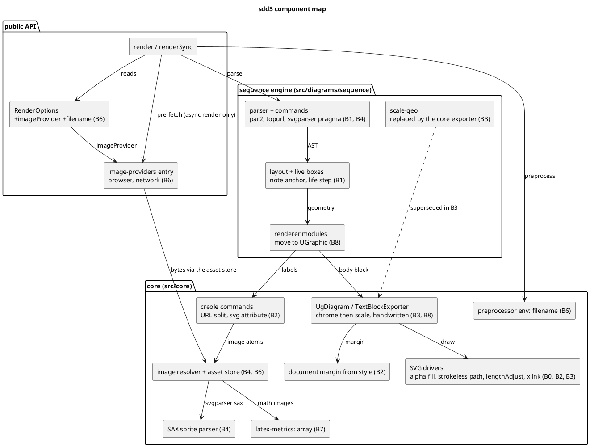

# sdd3 — component map

Components the drive touches, grouped by layer, with the batch that changes
each. Core components (bottom) reach every engine, so their batches run the
all-engine survey after every commit.

