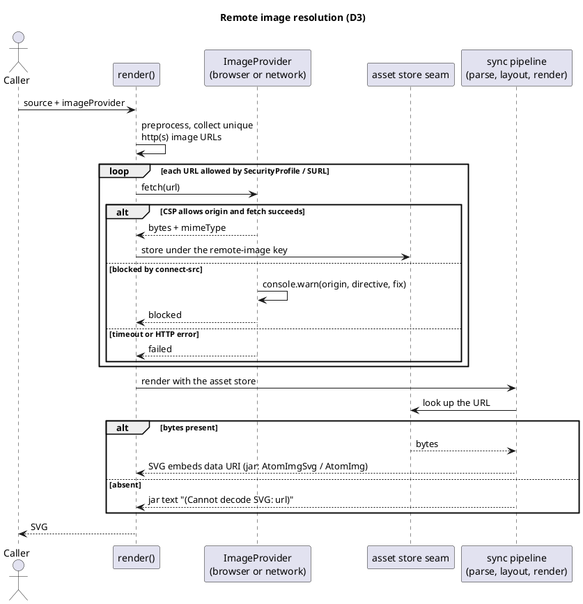
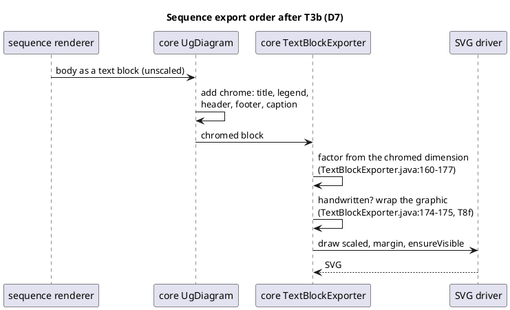
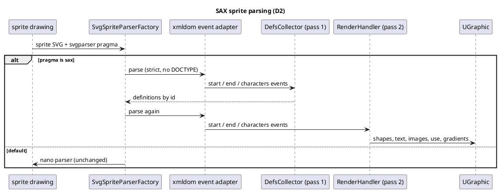

# sdd3 — data flows

Three flows change in this drive. Each diagram shows the target (post-sdd3)
behaviour, not the current one.

## 1. Remote images: async pre-fetch, sync render (D3)

`render()` resolves remote image URLs before the sync pipeline runs;
`renderSync` never fetches.

## 2. Sequence export: chrome, then scale (D7)

The jar composes the chrome around the body first and applies the export
scale to the whole block, the factor taken from the chromed size.

## 3. SAX sprite parsing: two passes (D2)

