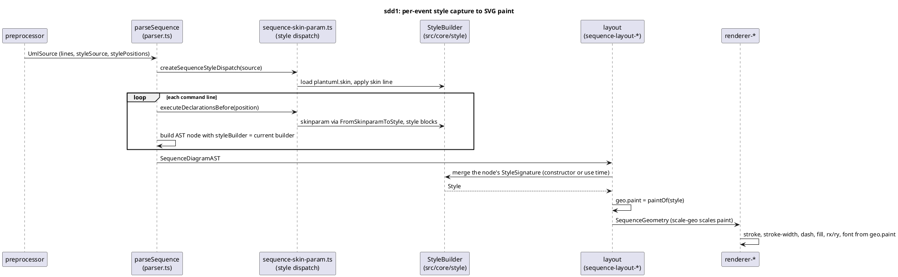

# Data flow — how a style value reaches a sequence element (after sdd1)

Proposed state. Before sdd1 the layout and renderer read `theme.colors` /
`theme.sequence`, and shadowing came from one per-document resolution in
`build-theme.ts`; batch 3b deletes that path.

