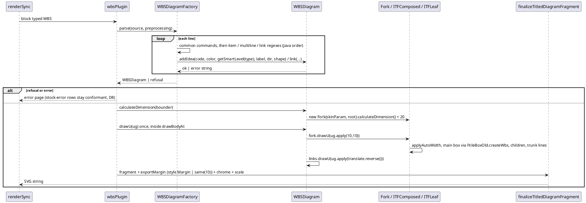

# Data flow: rendering one `@startwbs` source

Measurement at every close: `renderFixtureWbs` (same path) → `compareSvg` against
`test-results/dot-cache/wbs/<slug>/in.svg` → survey verdict / ratchet / diff-baseline.
